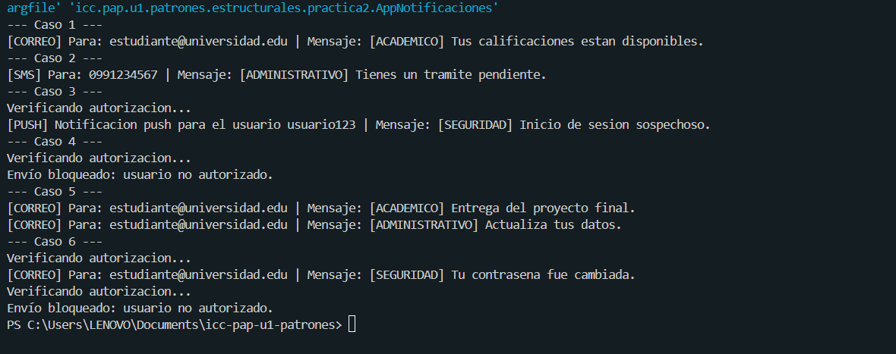

# Práctica Bridge y Proxy

En esta práctica hice un sistema de notificaciones en Java. Se pueden mandar mensajes por correo, SMS y push, y todo se simula con mensajes en consola.

## Qué hice

**Bridge:** separé los tipos de notificación de los canales de envío. Así puedo combinarlos como quiera sin hacer una clase para cada combinación.
- Tipos: académica, administrativa y de seguridad.
- Canales: correo, SMS y push.

**Proxy:** hice una clase que revisa si el usuario está autorizado antes de enviar el mensaje. Si está autorizado, lo envía por el canal. Si no, muestra "Envío bloqueado: usuario no autorizado." y el canal no se ejecuta.

## Clases

- `CanalEnvio`: interfaz con el método `enviar`.
- `CanalCorreo`, `CanalSMS`, `CanalPush`: los canales.
- `Notificacion`: clase abstracta que guarda el canal.
- `NotificacionAcademica`, `NotificacionAdministrativa`, `NotificacionSeguridad`: cada una agrega su prefijo al mensaje.
- `ProxyCanalEnvio`: revisa la autorización.
- `AppNotificaciones`: el main con los 6 casos de prueba.

## Pruebas

1. Académica por correo.
2. Administrativa por SMS.
3. Seguridad por push con proxy autorizado.
4. Académica por SMS con proxy sin autorización (se bloquea).
5. Mismo canal de correo usado con dos tipos de notificación.
6. Dos de seguridad con proxy: una autorizada por correo y otra bloqueada por SMS.

## Cómo ejecutarlo

Se ejecuta `AppNotificaciones` y se revisa la consola.

## Conclusión

Con Bridge puedo combinar tipos de notificación y canales fácilmente, y con Proxy agregué el control de acceso sin cambiar las clases que ya tenía.

## Captura de los resultados
